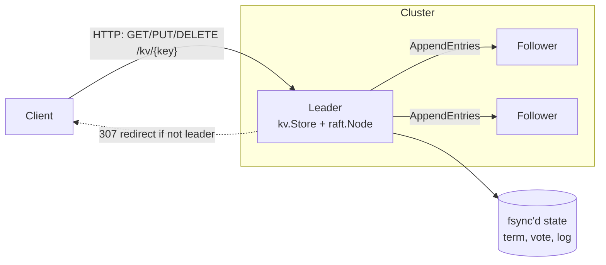

# raftkv

A linearizable, fault-tolerant key-value store built on a from-scratch implementation of the [Raft consensus algorithm](https://raft.github.io/raft.pdf), in Go with no external dependencies.

The focus of this project is **proving correctness under failure**, not just making it work on a good day. It includes a fault-injecting network simulator, a Jepsen-style linearizability checker, and a mutation-testing record showing that the test suite catches real consensus bugs when they are planted.

## Architecture



| Package | Responsibility |
|---|---|
| `raft` | Leader election, log replication, commit rules, write-ahead log |
| `kv` | Replicated state machine, exactly-once client semantics, leader-seeking client |
| `linearizability` | Checker for concurrent histories (Wing & Gong search with memoization) |
| `netsim` | In-process network that partitions nodes, drops and delays messages |
| `transport` | HTTP/JSON RPC transport for real multi-process deployments |
| `cmd/raftkv` | Server binary with a REST API |
| `cmd/bench` | Throughput/latency benchmark against a real multi-node cluster |

## Key design decisions

- **Every read goes through the log.** A leader cut off in a minority partition still believes it is leader, so serving reads from local state can return stale data. Routing reads through Raft makes them linearizable (the test suite demonstrates the failure when this is removed; see below).
- **Exactly-once writes.** Clients tag requests with `(ClientID, Seq)`; the state machine records the last applied `Seq` per client, so a write retried after a timeout or leader change is never applied twice.
- **Leader no-op on election.** A new leader cannot count replicas to commit entries from earlier terms (Raft §5.4.2, "Figure 8"). Appending a no-op in its own term lets those entries commit promptly and safely.
- **Fast log backtracking.** Followers return a conflict term and index, so a leader repairs a divergent follower one *term* per round trip rather than one entry.
- **Append-only write-ahead log.** Each state change writes only what changed (new entries, a truncation point, or a new term/vote) as CRC-checked records, then fsyncs once. A torn record from a crash mid-write fails its checksum and is discarded on recovery. A persistence failure panics (fail-stop), because continuing could let a node vote twice in one term.
- **One replication pipeline per follower.** Each follower gets a dedicated loop with at most one AppendEntries in flight. Proposals that arrive while an RPC is outstanding are batched into the next one (see Performance for why this mattered).
- **Lock discipline.** The Raft mutex is never held across an RPC or a send to the state machine, so a slow peer or a slow apply cannot stall the node.

## Testing methodology

All tests run under Go's race detector.

**Safety invariant, checked on every apply.** The Raft test harness records every committed entry on every node and fails if two nodes ever apply different commands at the same index, or apply out of order.

**Chaos tests.** A randomized nemesis crashes and restarts minorities, partitions the cluster, and drops up to 20% of messages with random delay, while clients keep issuing requests.

**Linearizability checking.** `TestLinearizableUnderFaults` runs 5 concurrent clients (two read-only, three mixed) against a 5-node cluster under the nemesis, records the invocation and response time of every operation, and verifies the whole history is linearizable. A typical run checks 4,000–5,000 operations across ~12 injected faults and ~50,000 RPCs (~10% dropped).

**Deterministic scenario tests.** Some bugs need an interleaving too precise for random testing. `TestFigure8Deterministic` reconstructs Figure 8 of the Raft paper node by node and checks both the commit rule and the election that would lose data if the rule were broken.

### Mutation testing: does the suite catch real bugs?

A test suite that always passes proves nothing, so I planted known Raft bugs and checked that the tests fail:

| Planted bug | Caught by | Notes |
|---|---|---|
| Voters skip the "log at least as up to date" check (§5.4.1) | `TestChaos` | Conflicting commits at dozens of indices within seconds |
| Leader commits earlier-term entries by counting replicas (§5.4.2) | `TestFigure8Deterministic` | Randomized tests **missed** this, even with latency added: the leader no-op masks it in almost every interleaving. It needed a deterministic reconstruction. |
| Follower truncates its log on every AppendEntries, even without a conflict | `TestAppendEntriesIgnoresStaleDuplicate` | A delayed duplicate RPC silently erases acknowledged entries |
| Leader serves reads from local state, skipping the log | `TestLinearizableUnderFaults` | Initially **missed**. Mixed read/write clients abandoned the partitioned leader too quickly for a stale read to occur. Adding read-only clients (realistic for caches and dashboards) exposed it in 3 of 4 runs. |

The two initial misses shaped the test design: random testing plus targeted deterministic tests, and workloads that model real client behavior.

## Performance

Real cluster: every node runs Raft over HTTP on localhost with its own fsync'd WAL. Clients issue 128-byte PUTs against the leader; 1 s warm-up, 5 s measured. Hardware: 2 vCPU Intel Xeon @ 2.1 GHz cloud VM (all nodes share the 2 cores, so these numbers are conservative).

| Nodes | Clients | Throughput (ops/s) | p50 | p99 | p99.9 |
|---|---|---|---|---|---|
| 1 | 1 | 4,684 | 0.19 ms | 0.51 ms | 1.52 ms |
| 1 | 16 | 5,354 | 2.88 ms | 6.46 ms | 8.60 ms |
| 1 | 64 | 5,231 | 11.89 ms | 23.50 ms | 28.19 ms |
| 3 | 1 | 1,400 | 0.67 ms | 1.59 ms | 3.14 ms |
| 3 | 16 | 3,896 | 3.87 ms | 8.68 ms | 11.73 ms |
| 3 | 64 | 4,238 | 13.30 ms | 38.23 ms | 53.19 ms |
| 5 | 1 | 1,170 | 0.80 ms | 2.02 ms | 4.07 ms |
| 5 | 16 | 3,464 | 4.38 ms | 9.32 ms | 15.98 ms |
| 5 | 64 | 4,704 | 13.04 ms | 26.78 ms | 31.95 ms |

Reproduce with `go run ./cmd/bench -nodes 1,3,5 -clients 1,16,64 -duration 5s`.

### What the benchmark found

1. **A liveness bug.** The first benchmark run hung on a 1-node cluster: `commitIndex` only advanced when a *follower* acknowledged an entry, so a cluster with no followers never committed. None of the correctness tests used a single node. Fixed, with a regression test (`TestSingleNodeCommits`).
2. **A 19× throughput bottleneck.** The original leader spawned a separate RPC per follower for *every* proposal. Under load, dozens of tiny AppendEntries raced over a handful of HTTP connections. Replacing that with one batching pipeline per follower took a 3-node cluster with 16 clients from **201 → 3,896 ops/s**, and p99 latency from **122 ms → 8.7 ms**. The full chaos and linearizability suite, plus all four planted-bug checks, were re-run after the change.

**Where the ceiling is now:** a single node is fsync-bound (one fsync per proposal, ~5,300 ops/s). Group commit (one fsync for many proposals) is the next step.

## Running it

Requires Go 1.22+.

```bash
go test -race ./...                                     # full suite
CHAOS_RUNS=20 go test ./kv -run Linearizable -v         # 20 seeded chaos runs
go test -short ./...                                    # skip chaos tests
```

Local 3-node cluster:

```bash
./scripts/cluster.sh start
curl -L -X PUT localhost:7001/kv/city -d Cincinnati     # any node; redirects to leader
curl -L localhost:7003/kv/city                          # -> Cincinnati
curl localhost:7002/status                              # role, term, leader
./scripts/cluster.sh kill 1                             # kill a node; cluster keeps serving
./scripts/cluster.sh stop
```

## Limitations and roadmap

These are deliberate scope limits for this stage, listed honestly:

- [ ] **Log compaction and snapshots.** The log grows without bound, and restart replays it from the start.
- [ ] **Group commit** on the leader: one fsync covering many concurrent proposals.
- [ ] **ReadIndex reads** to serve linearizable reads without a log append.
- [ ] **Dynamic membership changes** (joint consensus or single-server changes).
- [ ] Docker Compose deployment and a Prometheus metrics endpoint.

## References

- D. Ongaro and J. Ousterhout, *In Search of an Understandable Consensus Algorithm*, USENIX ATC 2014.
- M. Herlihy and J. Wing, *Linearizability: A Correctness Condition for Concurrent Objects*, TOPLAS 1990.
- G. Lowe, *Testing for Linearizability*, Concurrency and Computation 2017.
- Kyle Kingsbury's [Jepsen](https://jepsen.io) analyses, which inspired the nemesis design.
